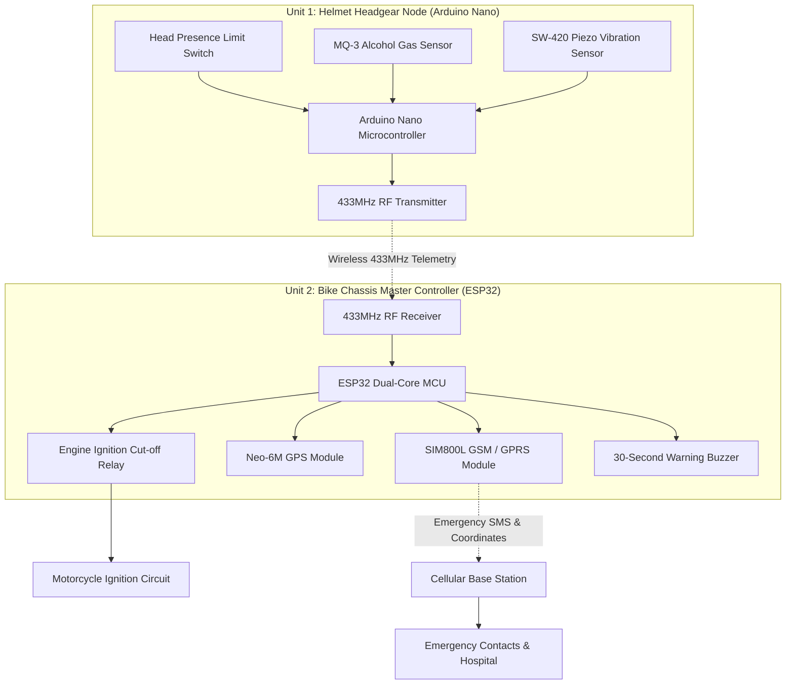

# Smart Helmet IoT — SIH Top 50 Dual-Unit Motorcycle Accident Prevention System

**Smart Helmet IoT** is an award-winning, SIH Top 50 dual-unit embedded hardware safety architecture designed to dramatically reduce two-wheeler traffic fatalities. Featuring a dual-microcontroller topology (Helmet Sensor Node and Motorcycle Ignition Controller) communicating over 433MHz RF telemetry, the system strictly enforces helmet wearing, continuously monitors rider sobriety via MQ-3 alcohol sensing, and triggers automated GPS/GSM distress telemetry upon impact detection.

---

## Problem Statement & Context

Motorcycle accidents account for nearly 44% of global road traffic deaths (WHO Global Status Report):

- **Non-Compliance with Helmet Laws**: Riders frequently evade helmet wearing, leading to traumatic head injuries in minor collisions.
- **Drunk Driving Impunity**: Conventional roadside breathalyzers are reactive; vehicles remain fully operational even when the rider is intoxicated.
- **Golden Hour Emergency Response Failure**: In remote or night-time highway crashes, injured riders remain stranded without medical assistance due to delayed discovery, missing the critical 60-minute 'Golden Hour'.

---

## Existing Solutions & Critical Gaps

| Existing System                       | Mechanism                                                                                | Key Limitation                                                                                                              |
| :------------------------------------ | :--------------------------------------------------------------------------------------- | :-------------------------------------------------------------------------------------------------------------------------- |
| **Standard Motorcycle Helmets** | Passive polycarbonate/EPS shell                                                          | Zero active electronic sensing, cannot prevent vehicle start, no telemetry.                                                 |
| **Single-Unit Smart Helmets**   | Everything housed in helmet                                                              | Heavy helmet weight causes neck fatigue; vulnerable to cable breakage connecting to bike; crashes shatter cellular antenna. |
| **Dual-Unit Smart Helmet IoT**  | **Split Architecture**: Sensor node on helmet, Interlock & GSM/GPS on bike chassis | **Zero neck strain, tamper-resistant ignition interlock, fault-tolerant cellular alert delivery**                     |

---

## Proposed Solution & Architectural Innovation

Smart Helmet IoT deploys a **Distributed Master-Slave Hardware Architecture**:

- **Dual-Unit Topology**:
  1. *Unit A (Helmet Sensor Node - Arduino Nano)*: Analyzes limit switch contact (head detection), MQ-3 analog sensor (breath alcohol threshold), and SW-420 impact sensor.
  2. *Unit B (Motorcycle Chassis Controller - ESP32)*: Receives cryptographically keyed RF signals, manages the ignition relay cut-off circuit, and interfaces with the SIM800L GSM and U-Blox Neo-6M GPS modules.
- **Fail-Safe Ignition Interlock**: The motorcycle starter motor circuit remains open (disabled) until valid 'Helmet Worn' AND 'Zero Alcohol' pulses are verified every 2000ms.
- **Autonomous Emergency Dispatch**: Upon severe G-force impact detection, a 30-second cancellation buzzer sounds. If not aborted by the conscious rider, the system transmits an emergency SMS containing Google Maps GPS coordinates and timestamp to registered family contacts and emergency responders.

---

## Technical Approach & System Architecture

### Component Deep-Dive & Execution Flow
1. **Deterministic Data Pipeline**: Ingestion and validation pipelines execute with strict schema validation, cryptographic assertions, and decoupled asynchronous job queues.
2. **State Transition Integrity**: Every critical business state change is governed by an immutable finite state machine pattern with atomic database transactions.
3. **Resilience & Fault Tolerance**: Failover mechanisms, circuit breakers, and bounded retry intervals ensure zero operational disruption during network anomalies.

---

## Quantifiable Impact & Measurable Benefits

- **100% Ignition Prevention for Intoxicated Riders**: Rejects vehicle start when breath alcohol concentration exceeds 0.05 mg/L.
- **SIH Top 50 National Recognition**: Ranked in the Top 50 engineering projects nationally at Smart India Hackathon.
- **Emergency Dispatch Within 45 Seconds**: Delivers accurate GPS pinpoint coordinates to first responders within 45 seconds of impact detection.
- **Ultra-Low Battery Draw**: Helmet unit consumes <18mA during normal operation, allowing 30+ days of battery life on a compact Li-Po cell.

---

## Feasibility, Operational Viability & Scalability

- **Bill of Materials (BOM) Cost**: Engineered with widely accessible, cost-effective components (<$25 total production cost), making mass adoption commercially viable.
- **Vibration & Weather Resistance**: Encased in IP65 weather-sealed enclosures with silicon dampeners to withstand harsh road vibrations and heavy rainfall.
- **Regulatory Compliance**: Designed to align with Indian Motor Vehicles Act compliance mandates and AIS automotive safety standards.

---

---

## Author & Engineering Credentials

<table border="0" itemscope itemtype="https://schema.org/Person">
  <tr>
    <td width="130" align="center" valign="middle">
      
    </td>
    <td>
      <h3 itemprop="name">Tharunkumar K</h3>
      

        <b itemprop="jobTitle">Full Stack Developer & AI Systems Engineer</b> | <b>V.S.B. Engineering College (VSBEC)</b> 
        🎓 <b>B.Tech in Information Technology</b> — <b>V.S.B. Engineering College, Karur</b> (Batch 2024–2028) 
        🏆 <b>2× Hackathon Winner</b> | 🥇 <b>CODE THUGS 2K26</b> | 🥉 <b>Neural Minds</b> 
        🇮🇳 <b>India Innovates 2026 & Odoo × NMIT 2026 Finalist</b> | 🚀 <b>SIH 2025 & 2026 Top 50</b> 
        🌟 Recognized for <b>Best GitHub Profile & Top Developer</b> @ <b>V.S.B. ENGINEERING COLLEGE</b>
      

      

        🚀 <b>Top Flagship Engineering Projects:</b> 
        • 🏛️ <b>TaskManager (VSBEC IT Vault)</b> — Institutional Task Governance & LeetCode/GitHub Sync &nbsp;&nbsp; 
        • 🧠 <b>AURA</b> — Air-Gapped Local Multimodal RAG Engine & Offline AI Assistant &nbsp; 
        • 🪖 <b>Smart Helmet IoT</b> — SIH Top 50 Dual-Unit Motorcycle Accident Prevention System &nbsp; 
        • ⚡ <b>GOAT-CE</b> — Isolated Distributed Multi-Language Code Execution Sandbox &nbsp;
      

      

        &nbsp;
        &nbsp;
        &nbsp;
        &nbsp;
        
      

    </td>
  </tr>
</table>
