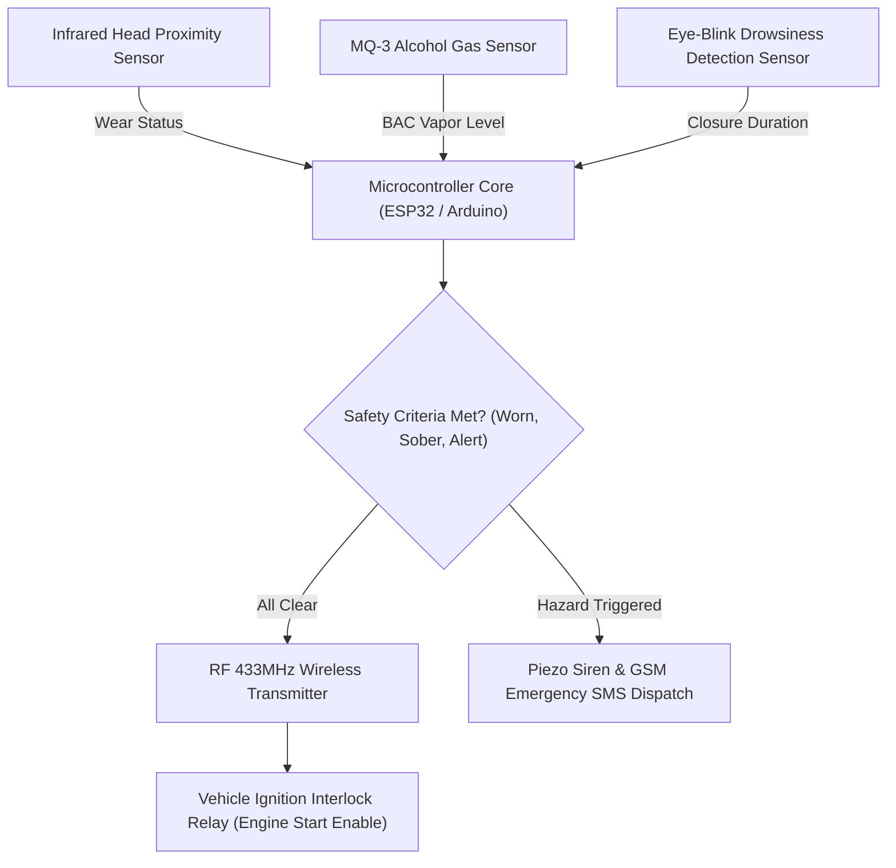

# 🪖 Smart Helmet IoT Safety System — Dual-Unit Embedded Motorcycle Accident Prevention System
### *Smart India Hackathon 2025 Top 50 Submission: Proactive Wireless Ignition Interlock, MQ-3 Alcohol Sensing, IR Wear Verification & Eye-Blink Drowsiness Monitoring*

    

  <a href="https://github.com/Tharun4743/AGILE-INNOVATORS-smart-helmet-">📦 <b>Official GitHub Repository</b></a>
  

---

## 1. 📌 Problem Statement & Context
### 🚨 The Global Two-Wheeler Fatality Crisis

Motorcycle and two-wheeler accidents represent one of the leading causes of preventable deaths and severe trauma worldwide. Over 75% of fatal crashes trace back to three critical behavioral factors:

* 🪖 **Helmet Non-Compliance:** Riders frequently avoid helmets or wear them unfastened, resulting in catastrophic head trauma upon collision.
* 🍺 **Drunk Driving (DUI):** Alcohol impairs motor reflexes, reaction times, and spatial judgment, causing catastrophic high-speed collisions.
* 😴 **Driver Fatigue & Microsleep:** Long-distance riders and night delivery workers experience sudden microsleep episodes (eyelid closures lasting 1–3 seconds), resulting in uncontrolled crashes before the rider can react.
* ⚠️ **The Flaw of Reactive Safety:** Existing motorcycle safety systems (airbags, crash alert beacons) are strictly reactive—they activate only after impact has already taken place.

---

## 2. 🔍 Existing Solutions & Critical Gaps
### 🔍 Analysis of Existing Vehicle Safety Systems

| Safety Metric | Standard Motorcycle Safety | Standalone Breathalyzers | 🪖 Smart Helmet IoT System |
| :--- | :---: | :---: | :---: |
| **Proactive Ignition Lock** | ❌ None | ⚠️ Standalone Bike Lock Only | ✅ Dual-Unit Interlock (Helmet + Bike) |
| **Helmet Wear Confirmation** | ❌ None | ❌ Cannot Verify Helmet Wear | ✅ Optical IR Proximity Verification |
| **Microsleep Drowsiness Sensor**| ❌ None | ❌ None | ✅ Real-Time IR Eye-Blink Pattern Check |
| **Wireless Independence** | ❌ N/A | ⚠️ Wired Tethers (Snag Risk) | ✅ 433MHz Wireless RF (100ms Packet) |
| **Tamper & Loss Failsafe** | ❌ None | ❌ Easy to Bypass | ✅ 5-Second RF Signal Loss Auto-Cutoff |
| **Real-Time Rider Feedback** | ❌ None | ⚠️ Basic LED Indicator | ✅ 16x2 I²C LCD Telemetry Dashboard |

---

## 3. 💡 Proposed Solution & Architectural Innovation
### 💡 The Smart Helmet Proactive Hardware Solution

The **Smart Helmet IoT Safety System** is a dual-unit embedded hardware platform engineered by **Team Agile Innovators** for **Smart India Hackathon 2025**. It proactively prevents accidents by enforcing strict safety preconditions before the engine can start, and continuously monitoring rider state:

* 🪖 **Helmet Unit (Transmitter):** Scans if the helmet is securely buckled (IR proximity), measures breath alcohol levels (MQ-3 sensor), and monitors eye-blink frequency (IR optical sensor). Transmits encrypted telemetry packets wirelessly every **100ms** over 433MHz RF.
* 🏍️ **Bike Unit (Receiver):** Decodes wireless telemetry in real time. Controls a **5V Relay module** wired into the bike's ignition circuit, enabling motor operation **ONLY** when the helmet is worn AND the rider is sober.
* ⚡ **Instant Safety Interlocks:**
  * Alcohol detected → **Ignition instantly disabled + Loud alarm buzzer**.
  * Helmet unfastened → **Ignition remains disabled**.
  * Drowsiness / Microsleep detected → **Instant auditory buzzer alert while disengaging motor drive**.
  * RF communication lost for >5s → **Failsafe mode engages, automatically cutting ignition**.
* 🖥️ **Real-Time Telemetry Display:** 16x2 I²C LCD on the motorcycle dashboard cycling through real-time safety diagnostic pages.

---

## 4. ⚙️ Technical Approach & System Architecture

### 📐 High-Level Architectural Flowchart:

### ⚙️ Hardware Architecture & Interlock Logic

| Unit | Hardware Component | Specific Functional Role |
| :--- | :--- | :--- |
| **Helmet (TX)** | Arduino UNO / Nano (ATmega328P) | Reads sensory input and encodes safety telemetry data packets |
| **Helmet (TX)** | MQ-3 Alcohol Gas Sensor | Analyzes breath alcohol concentration in helmet airspace |
| **Helmet (TX)** | Optical IR Proximity Sensor | Confirms physical contact between helmet shell and rider's head |
| **Helmet (TX)** | IR Eye-Blink Sensor | Measures eyelid blink duration and frequency to detect microsleep |
| **Helmet (TX)** | 433MHz RF Transmitter (RH_ASK) | Dispatches safety packets wirelessly every 100ms |
| **Bike (RX)** | 433MHz RF Receiver Module | Receives telemetry packets and passes payload to bike microcontroller |
| **Bike (RX)** | 5V Single-Channel Relay | Physically opens/closes vehicle ignition circuit based on safety status |
| **Bike (RX)** | 16x2 I²C LCD Display (0x27) | Cycles through diagnostic pages (Helmet Status, Alcohol Level, Motor State) |
| **Bike (RX)** | Active Piezo Buzzer | Emits high-decibel auditory alarms on dangerous rider states |

---

## 5. 📈 Quantifiable Impact & Measurable Benefits
### 📈 Hackathon Validation & Life-Saving Outcomes

* 🏆 **Smart India Hackathon 2025 Top 50 (Internal):** Shortlisted in the Top 50 out of 300+ campus teams and officially nominated for the central SIH portal.
* ⚡ **Sub-500ms Emergency Response:** Cuts vehicle ignition within half a second upon detecting dangerous alcohol levels or persistent eye closure.
* 🛡️ **Proactive Accident Prevention:** Proactively prevents riders from operating motorcycles under intoxicated or unhelmeted conditions.
* 🔒 **5-Second RF Failsafe:** Eliminates bypass tampering—if a rider removes the helmet or disables the transmitter, the motorcycle cannot be driven.

---

## 6. 🚀 Feasibility, Operational Viability & Scalability
### 🚀 Feasibility, Manufacturing Economics & Roadmap

* 🔬 **Technical Feasibility:** Validated with a fully functional physical hardware prototype demonstrating high RF noise penetration across motorcycle frames.
* 💰 **Economic Viability:** Built using low-cost microcontrollers and analog sensors, allowing the entire safety package to be manufactured for under $25 per unit in mass production.
* 📈 **OEM Commercial Scalability:** Easily integrated by original equipment manufacturers (OEMs) like Honda, Yamaha, TVS, and Royal Enfield directly into factory ignition circuits.
* 📱 **Future Roadmap:** Expansion to ESP32 modules with Bluetooth mobile telemetry, parent monitoring apps, and GPS emergency SOS beacons.

---

## 7. 👨‍💻 Engineering Author

<table border="0" itemscope itemtype="https://schema.org/Person">
  <tr>
    <td width="120" align="center" valign="top">
      
    </td>
    <td>
      <h3 itemprop="name">Tharunkumar K</h3>
      

        <b itemprop="jobTitle">Full Stack Developer & AI Systems Engineer</b> | <b>V.S.B. Engineering College (VSBEC)</b> 
        🎓 <b>B.Tech in Information Technology</b> — <a href="https://vsbec.com" target="_blank" itemprop="alumniOf" style="text-decoration: none;"><b>V.S.B. Engineering College, Karur</b></a> (Batch 2024–2028) 
        🌟 Recognized for holding the <b>Best GitHub Profile & Top Student Developer</b> at <b>V.S.B. Engineering College (VSBEC)</b> 
        🥇 <b>Winner — Code Thugs 2K26</b> • 🚀 <b>Smart India Hackathon (SIH)</b> Top 50 National Finalist • 🏆 <b>Odoo × NMIT</b> National Finalist • 🎓 <b>GFG Campus Mantri</b>
      

      

        🚀 <b>Top Flagship Engineering Projects:</b> 
        • 🏛️ <a href="https://github.com/Tharun4743/Taskmanager" style="text-decoration: none;"><b>TaskManager (VSBEC IT Vault)</b></a> — Institutional Task Governance & LeetCode/GitHub Daemon Sync (<a href="https://it-taskmanager.vercel.app/" style="text-decoration: none;">Live Portal</a>) 
        • 🧠 <a href="https://github.com/Tharun4743/AURA" style="text-decoration: none;"><b>AURA</b></a> — Air-Gapped Local Multimodal RAG Engine & Offline AI Knowledge Assistant 
        • 🪖 <a href="https://github.com/Tharun4743/AGILE-INNOVATORS-smart-helmet-" style="text-decoration: none;"><b>Smart Helmet IoT</b></a> — SIH Top 50 Dual-Unit Embedded Motorcycle Accident Prevention System
      

      

        <a href="https://tharunkumark4743.netlify.app/" target="_blank" rel="noopener me" style="text-decoration: none;">🌐 Tharunkumar K Portfolio</a> •
        <a href="https://github.com/Tharun4743" target="_blank" rel="noopener me" style="text-decoration: none;">🐙 GitHub (@Tharun4743)</a> •
        <a href="https://www.linkedin.com/in/tharunkumark4743" target="_blank" rel="noopener me" style="text-decoration: none;">💼 LinkedIn</a> •
        <a href="https://leetcode.com/u/Tharunkumar__K/" target="_blank" rel="noopener me" style="text-decoration: none;">🧩 LeetCode</a> •
        <a href="mailto:tharunkumark42007@gmail.com" itemprop="email" style="text-decoration: none;">📧 Email</a>
      

    </td>
  </tr>
</table>

<!-- =========================================================================
   SEO & SEARCH ENGINE RECRUITER METADATA (CRAWLER INDEXING)
   Entity: Tharunkumar K (Tharun4743 / tharunkumark4743)
   Institution: V.S.B. Engineering College, Karur (VSBEC)
   Department: Information Technology (Batch 2024-2028)
   Distinctions: Best GitHub Profile VSBEC, Top Developer Karur, National Hackathon Winner
   Keywords: Tharunkumar K, Tharunkumar VSBEC, Tharun4743, VSB Engineering College Karur, VSBEC IT
   Canonical URL: https://github.com/Tharun4743/SmartHelmet-IoT
========================================================================= -->
